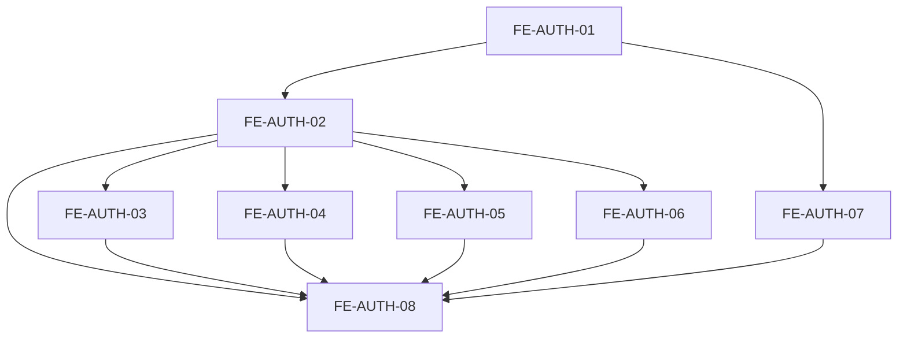

# Tarefas — telas de autenticação

## Ordem de execução



### FE-AUTH-01 — Implementar contratos, cliente HTTP e providers

**Requisitos:** FE-AUTH-RF-009, FE-AUTH-RF-011 e FE-AUTH-RF-012.

**Depende de:** contratos finais dos endpoints e erros do backend.

- criar DTOs tipados de autenticação;
- criar parser do envelope de erro existente;
- configurar origem da API e `credentials: "include"`;
- implementar refresh compartilhado e repetição única;
- excluir endpoints públicos de autenticação do refresh automático;
- limpar a Promise compartilhada em `finally`;
- compor `QueryClientProvider`, `Toaster` e um `AuthProvider` completo;
- implementar em `AuthProvider` a consulta de sessão, login, logout e invalidação;
- garantir que nenhum token seja persistido.

**Testes:** validação do cliente com respostas simuladas ou, sem ferramenta
aprovada, roteiro manual para cookies, refresh único e falha de sessão.

**Gate:** `yarn lint` e `yarn build`; refresh não entra em loop.

**Commit sugerido:** `feat(auth): add frontend authentication client`

### FE-AUTH-02 — Criar layout e componentes compartilhados

**Requisitos:** FE-AUTH-RF-012.

**Depende de:** FE-AUTH-01 e `DESIGN.md`.

- criar layout público sem `AppShell`;
- criar estrutura visual compartilhada com logo, card e navegação auxiliar;
- criar campo de senha com controle acessível de visibilidade;
- criar resumo de erro e estado de envio reutilizáveis;
- aplicar responsividade e tokens existentes.

**Testes:** teclado, foco, labels, `aria-live`, mobile e desktop.

**Gate:** `yarn lint`, `yarn build` e checklist acessível documentado.

**Commit sugerido:** `feat(auth): add authentication page layout`

### FE-AUTH-03 — Criar tela de login

**Requisitos:** FE-AUTH-RF-001, FE-AUTH-RF-002 e FE-AUTH-RF-012.

**Depende de:** FE-AUTH-02.

- criar schema sem transformar a senha;
- implementar formulário com `identifier` e `password`;
- integrar login e estado de sessão;
- exibir erro genérico de credenciais;
- adicionar links para cadastro e recuperação;
- redirecionar sucesso para `/`;
- ler mensagens pós-redirect por `status` em allowlist.

**Testes:** e-mail, username, campos vazios, erro genérico, envio duplicado e
sucesso.

**Gate:** `yarn lint`, `yarn build` e todos os cenários manuais aprovados.

**Commit sugerido:** `feat(auth): add login page`

### FE-AUTH-04 — Criar tela de cadastro

**Requisitos:** FE-AUTH-RF-003, FE-AUTH-RF-004 e FE-AUTH-RF-012.

**Depende de:** FE-AUTH-02 e decisões finais de telefone e senha.

- criar formulário com os seis campos da interface;
- validar confirmação de senha;
- remover `passwordConfirmation` do payload;
- mapear conflitos e validações do backend;
- redirecionar para login sem criar sessão.

**Testes:** validações, senhas divergentes, conflito, payload seguro e sucesso.

**Gate:** `yarn lint`, `yarn build` e payload inspecionado sem campos internos.

**Commit sugerido:** `feat(auth): add registration page`

### FE-AUTH-05 — Criar solicitação de recuperação

**Requisitos:** FE-AUTH-RF-005 e FE-AUTH-RF-012.

**Depende de:** FE-AUTH-02.

- criar formulário de e-mail;
- integrar `POST /api/v1/auth/password-reset`;
- substituir o formulário pelo estado de confirmação após 202;
- manter texto neutro;
- permitir retorno ao login.

**Testes:** e-mail inválido, envio duplicado, confirmação neutra e navegação.

**Gate:** `yarn lint`, `yarn build` e texto idêntico para os cenários públicos.

**Commit sugerido:** `feat(auth): add forgot password page`

### FE-AUTH-06 — Criar definição de nova senha

**Requisitos:** FE-AUTH-RF-006, FE-AUTH-RF-007, FE-AUTH-RF-008 e
FE-AUTH-RF-012.

**Depende de:** FE-AUTH-02 e política final de senha.

- ler token com `useSearchParams` dentro de `Suspense`;
- guardar token somente em memória e remover a query com `router.replace`;
- aplicar `no-store` e `Referrer-Policy: no-referrer` em `next.config.ts` ou na
  borda HTTP equivalente;
- exigir sanitização da query no proxy e na hospedagem;
- impedir recursos e analytics de terceiros nessa página;
- bloquear formulário quando o token estiver ausente;
- validar senha e confirmação;
- integrar o endpoint de confirmação;
- unificar token inválido, expirado e usado no mesmo estado;
- limpar campos e redirecionar sucesso para login.

**Testes:** token ausente, inválido, expirado, senhas divergentes e sucesso.

**Gate:** `yarn lint`, `yarn build`; storage, URL, cache, referrer e logs
inspecionados sem token.

**Commit sugerido:** `feat(auth): add password reset page`

### FE-AUTH-07 — Implementar estado e proteção de sessão

**Requisitos:** FE-AUTH-RF-009, FE-AUTH-RF-010 e FE-AUTH-RF-011.

**Depende de:** FE-AUTH-01, endpoint `/api/v1/auth/me` implementado e decisões
de topologia e organização privada aprovadas.

- implementar a opção aprovada de guarda e layout privado;
- proteger a área privada sem confiar somente na presença do cookie;
- redirecionar autenticado para fora das páginas públicas;
- integrar logout ao menu existente;
- limpar cache privado depois do logout;
- impedir ciclos de redirect e refresh.

**Testes:** sessão válida, access expirado, refresh falho, rota privada, rota
pública autenticada e logout repetido.

**Gate:** `yarn lint`, `yarn build` e matriz de navegação aprovada.

**Commit sugerido:** `feat(auth): protect authenticated routes`

### FE-AUTH-08 — Validar integração e documentar

**Requisitos:** todos.

**Depende de:** FE-AUTH-02, FE-AUTH-03, FE-AUTH-04, FE-AUTH-05, FE-AUTH-06 e
FE-AUTH-07.

- validar os quatro fluxos contra o backend disponível;
- verificar teclado, foco, responsividade e mensagens em português;
- inspecionar cookies e storages sem expor seus valores;
- atualizar documentação somente com comportamento comprovado;
- registrar falhas externas e verificações não executadas.

**Testes:** roteiro integrado completo em desktop e mobile.

**Gate:** `yarn lint`, `yarn build` e critérios de aceitação verificados com
evidências.

**Commit sugerido:** `docs(auth): document frontend authentication flows`

## Matriz de cobertura

| Requisito | Tarefas | Evidência esperada |
| --- | --- | --- |
| FE-AUTH-RF-001, 002 | FE-AUTH-03 | login e erros públicos |
| FE-AUTH-RF-003, 004 | FE-AUTH-04 | cadastro e payload |
| FE-AUTH-RF-005 | FE-AUTH-05 | confirmação neutra |
| FE-AUTH-RF-006 | FE-AUTH-06 | token fora de URL, storage e logs |
| FE-AUTH-RF-007 | FE-AUTH-06 | token ausente, inválido e expirado |
| FE-AUTH-RF-008 | FE-AUTH-06 | redirect e mensagem fixa |
| FE-AUTH-RF-009 | FE-AUTH-01, 07 | cookies e ausência de storage |
| FE-AUTH-RF-010 | FE-AUTH-07 | matriz de navegação |
| FE-AUTH-RF-011 | FE-AUTH-01, 07 | refresh único sem recursão |
| FE-AUTH-RF-012 | FE-AUTH-02 a 06 | estados e anúncio acessível |

## Matriz de navegação

| Estado | Rota pública | Rota privada |
| --- | --- | --- |
| Não autenticado | Permanece | Redireciona para `/login` |
| Autenticado | Redireciona para `/` | Permanece |
| Access expirado, refresh válido | Renova e redireciona | Renova e permanece |
| Refresh inválido | Permanece | Redireciona para `/login` |

## Comandos de verificação

Execute no diretório `frontend` usando Yarn 4:

```powershell
yarn lint
yarn build
```

Não existe script de testes no `package.json` atual. A instalação de uma
ferramenta de testes exige aprovação antes da alteração das dependências.

## Bloqueios antes das tarefas afetadas

- fechar política de senha antes de FE-AUTH-04 e FE-AUTH-06;
- fechar máscara e formato de telefone antes de FE-AUTH-04;
- fechar estratégia CSRF antes da integração final;
- escolher topologia de frontend/API antes de FE-AUTH-07;
- escolher organização das páginas privadas antes de FE-AUTH-07;
- garantir sanitização da query nos logs do proxy e hospedagem antes de
  FE-AUTH-06 ou aprovar token no fragmento com mudança no backend;
- resolver a divergência de fontes entre `DESIGN.md` e o root layout antes do
  acabamento visual;
- implementar os endpoints correspondentes no backend antes do gate integrado;
- aprovar ferramenta de testes se testes automatizados forem exigidos.

## Documentação posterior

Depois da implementação, atualizar a documentação geral com:

- rotas públicas realmente entregues;
- comportamento da sessão e dos redirects;
- fluxo completo de recuperação;
- limitações e decisões pendentes resolvidas.
